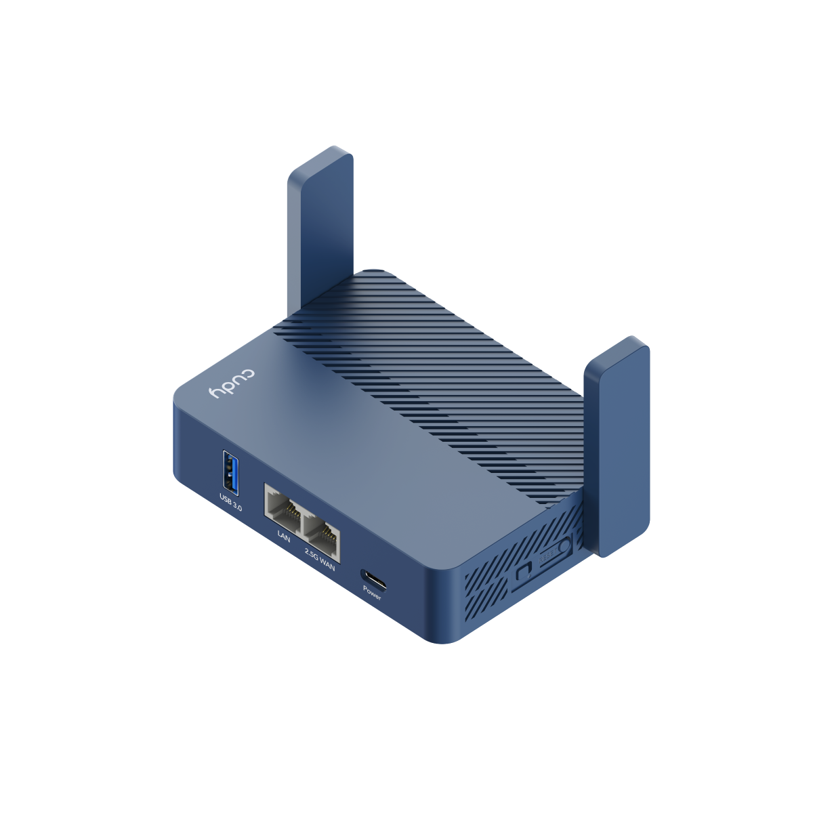
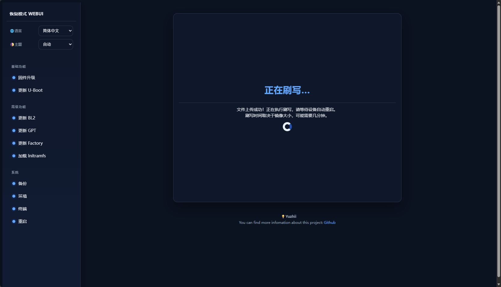

[定制教程](https://xiabee.eu.org/customize.html) | [刷写教程](https://xiabee.eu.org/install.html)

<div align=center>

</div>

---

## immortalwrt 源码

编译自 https://github.com/padavanonly/immortalwrt-mt798x-6.6 ，兼容 Cudy Tr3000 128M 新 flash

---

## 大分区 ubootmod 固件

本仓库默认编译的 ubootmod 固件为 112M 分区，若你想编译 122M 分区固件，请将 `diy-part2.sh` 中取消以下注释：

```sh
# set ubi to 122M
# sed -i 's/reg = <0x5c0000 0x7000000>;/reg = <0x5c0000 0x7a40000>;/' target/linux/mediatek/dts/mt7981b-cudy-tr3000-v1-ubootmod.dts
```

---

## DHCP uboot

编译自 https://github.com/weekdaycare/bl-mt798x-dhcpd 感谢大佬开源，兼容新 flash



128M uboot 为三分区 uboot 支持原厂 ubi 大小 64MB，扩容 ubi 分区 112MB，最大 ubi 分区 122MB

## USB 供电控制

上游的最新源码已经打开了默认供电，具体可以见这条 [commit](https://github.com/padavanonly/immortalwrt-mt798x-6.6/commit/86356f8a2f796e5808fda25ce3e3bf6b3cc3278e)

若你想关闭 USB 供电执行命令

```bash
echo 0 > /sys/class/gpio/modem_power/value
```

恢复供电执行命令

```bash
echo 1 > /sys/class/gpio/modem_power/value
```

---

## 第三方软件包

- [定制 PassWall2 26.10.20-r5](https://github.com/localhost-copilot/openwrt-passwall2)：固定源码提交 `d4f79af3b6984da958b15f832b681db4cffec456`（包版本仍为 r5），内置中文界面、独立断线保护及 SHA-256 校验的官方 Xray 26.10.31 ARM64 核心。客户端 TCP / UDP 通过配置的节点访问外网。
- “实时监控”页提供 WAN 流量曲线、CPU / 内存、出口 IP 和保护状态；设备速率复用 Bandix，需单独开启其流量统计。页面不依赖外部 CDN，退出页面后停止采样。
- 新版包含链路总览和有界流量历史。固件默认关闭 `passwall2_history`，避免为仪表盘自动开启闪存写入；需要历史时手动执行 `/etc/init.d/passwall2_history enable` 和 `/etc/init.d/passwall2_history start`。已有历史文件随配置保留，刷入新固件后需重新开启采集。
- 专用路由器默认开启“断线禁止直连”：代理停止或节点不可达时阻止直连。全新安装需配置并开启 IPv4 节点才可上网；管理页和 SSH 仍通过 LAN 使用。此功能不支持自动展开域名、分流或链式节点，详见 [定制说明](https://github.com/localhost-copilot/openwrt-passwall2/blob/main/CUSTOMIZATION.md)。
- 固件不再包含旧 WireGuard Reality 管理插件、OpenClash / VoHive。保留配置升级会保留 PassWall2 节点、保护规则和旧 `/etc/wg-reality/` 资料；先启用新保护再移除旧规则。迁移将 Xray 路径切换到内置 `/usr/bin/xray`。刷机前仍需导出备份。
- 两个项目均托管于 `localhost-copilot` 的公开仓库，GitHub Actions 无需部署密钥即可检出固定提交。本地构建默认从同级 `../openwrt-passwall2` 读取固定提交，可设置 `PASSWALL2_SOURCE` 指定路径。
- PassWall 依赖 feed 和新版 Go 构建工具也固定提交；旧 feed 的 Go 1.23 无法编译 geoview 0.2.8。构建结束会检查 PassWall2 / Xray 的实际 manifest 版本。默认构建目标为 `128M-Ubootmod`（112M UBI）。
- [Bandix](https://github.com/timsaya/luci-app-bandix)
- 默认主题为 [Vantage v1.0.12](https://github.com/anothaDev/luci-theme-vantage/releases/tag/v1.0.12)，固定源码提交 `430e77c0f166f87235289fb45aeda843ca0bdc24`，包含仪表盘和主题 / 仪表盘中文包，替换 Aurora 及其配置插件；保留 Bootstrap 作为备用主题。
- 两种设备配置均启用 Vantage。新固件首次启动时（包括保留配置升级）会切换到 Vantage，之后可在“系统 → 系统 → 语言和界面”自行切换；本地和 Actions 构建均检查包是否启用以及产物 manifest 中的版本。
- luci-app-ttyd
- luci-app-upnp
- kmod-usb-net-cdc-ether
- kmod-usb-net-cdc-mbim
- kmod-usb-net-cdc-ncm
- kmod-usb-net-qmi-wwan
- kmod-usb-serial-option
- luci-proto-mbim
- luci-proto-ncm
- luci-proto-qmi
- uqmi
- umbim
- kmod-usb-net-rndis
- kmod-mtd-rw

---

## 升级与断线保护

升级到**本仓库构建的固件**时，PassWall2 和 Xray 由新固件内置；选择保留配置会保存节点、`/etc/passwall2/` 中的规则 / 历史和旧 `/etc/wg-reality/` 备份。普通系统升级备份只保存配置，不会把这些定制软件包自动装进其他上游固件。

保护服务在网络启动前运行；转发和路由器出站默认拒绝，停止代理不会移除保护，防火墙重载会重放已保存的规则。数值 IP 节点、DHCP 和指定 NTP 是明确放行的控制流量，客户端不能因此直接访问公网。保留配置升级仍会重新启用专用路由器的断线保护。

`scripts/test-passwall2-migration.sh` 在一次性 OpenWrt 容器中验证真实 `sysupgrade` 备份 / 恢复及迁移失败时保留旧保护。设置 `TEST_PACKET_LEAKS=1` 还会调用 `scripts/test-passwall2-leaks.sh`，用隔离网络验证 IPv4 TCP、IPv6 TCP、UDP/53 在升级后、保护服务停止、节点不可达、防火墙重载和规则生成 / 应用失败时均不能直连。发包测试需要 privileged 容器、`ip-full` 和 `socat`，禁止在真实路由器运行这些测试脚本。

这些检查覆盖配置迁移与防绕过行为，尚未替代完整新固件的实机刷写和重启验证。

---

## SSH 连接 Action

可以通过 ssh 连接到 Action 工作流来配置 `menuconfig` 。

手动运行 `ImmortalWrt Builder`，选择单个设备（不能选 `all`），并勾选 SSH 选项。
工作流使用 Upterm 公共中继提供 SSH 会话，仅允许使用触发者 GitHub 账号上的 SSH 公钥连接。
在 `SSH connection to Menuconfig` 步骤的日志中找到 SSH 连接命令；连接后执行：

```sh
cd /workdir/openwrt
make menuconfig
# 保存并退出 menuconfig 后，通知工作流继续推送配置和编译：
touch "$GITHUB_WORKSPACE/continue"
```

SSH 步骤最多运行 15 分钟，请在超时前保存配置并创建 `continue` 文件；直接取消运行或超时会跳过配置推送。
如果不显示连接命令，可在 GitHub 的 Re-run jobs 中勾选 Enable debug logging，
检查 Upterm 启动日志及到 `uptermd.upterm.dev` 的连接情况。

---

## 编译注意事项

GitHub Actions 存储有限，大型软件包（如 sing-box 或 alist）建议使用预编译方式，而不是源码编译，即在编译过程中加入已经编译好现成软件包。否则你应该会碰到超长编译时间 + 超出 Action 储存。示例：

```sh
# 创建存储二进制文件的目录
BIN_DIR="$GITHUB_WORKSPACE/openwrt/files/usr/bin"
mkdir -p "$BIN_DIR"

# -------- 下载并解压 xray-core ARM64 -------
echo "Downloading xray-core..."
curl -fL -o xray.zip https://github.com/XTLS/Xray-core/releases/download/v26.10.31/Xray-linux-arm64-v8a.zip
echo '1811c8f1da0c3b6dc707ebaf1c8390e987ba39859a8f0a7aadd8526157f2ec8d  xray.zip' | sha256sum -c - || exit 1
unzip -o xray.zip -d "$BIN_DIR"
chmod +x "$BIN_DIR/xray"
rm xray.zip

# -------- 下载并解压 sing-box ARM64 -------
echo "Downloading sing-box..."
curl -L -o sing-box.tar.gz https://github.com/SagerNet/sing-box/releases/download/v1.12.12/sing-box-1.12.12-linux-arm64.tar.gz
TMP_DIR=$(mktemp -d)
tar -xzf sing-box.tar.gz -C "$TMP_DIR"
mv "$TMP_DIR"/sing-box-1.12.12-linux-arm64/sing-box "$BIN_DIR"/sing-box
chmod +x "$BIN_DIR/sing-box"
rm -rf "$TMP_DIR"
rm sing-box.tar.gz
```

---

## Credits

- [bl-mt798x-dhcpd](https://github.com/weekdaycare/bl-mt798x-dhcpd)
- [bl-mt798x](https://github.com/hanwckf/bl-mt798x)
- [immortalwrtwrt](https://github.com/padavanonly/immortalwrt-mt798x-6.6)
- [P3TERX](https://github.com/P3TERX)
- [Microsoft Azure](https://azure.microsoft.com)
- [GitHub Actions](https://github.com/features/actions)
- [OpenWrt](https://github.com/openwrt/openwrt)
- [coolsnowwolf/lede](https://github.com/coolsnowwolf/lede)
- [Mikubill/transfer](https://github.com/Mikubill/transfer)
- [softprops/action-gh-release](https://github.com/softprops/action-gh-release)
- [Mattraks/delete-workflow-runs](https://github.com/Mattraks/delete-workflow-runs)
- [dev-drprasad/delete-older-releases](https://github.com/dev-drprasad/delete-older-releases)
- [peter-evans/repository-dispatch](https://github.com/peter-evans/repository-dispatch)

---

## License

[MIT](https://github.com/P3TERX/Actions-OpenWrt/blob/main/LICENSE) © [**P3TERX**](https://p3terx.com)
